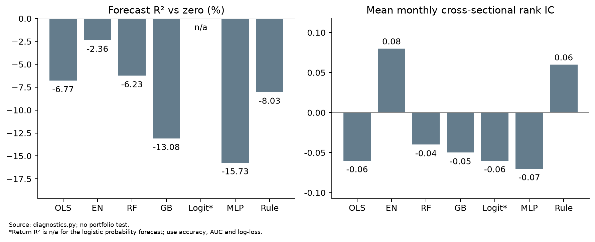
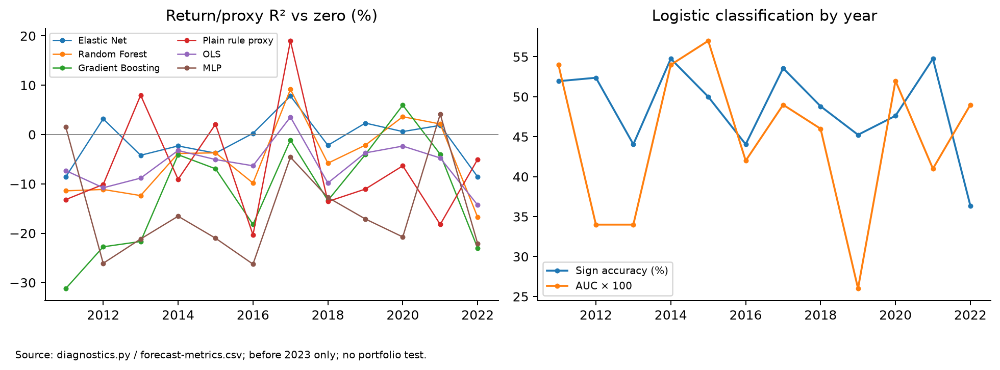
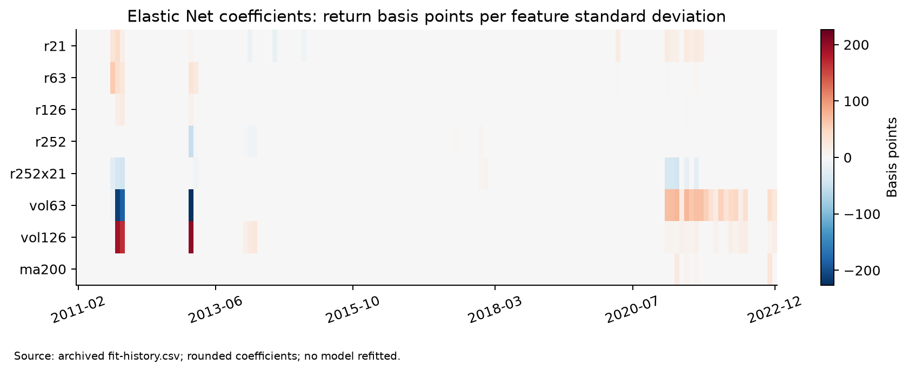
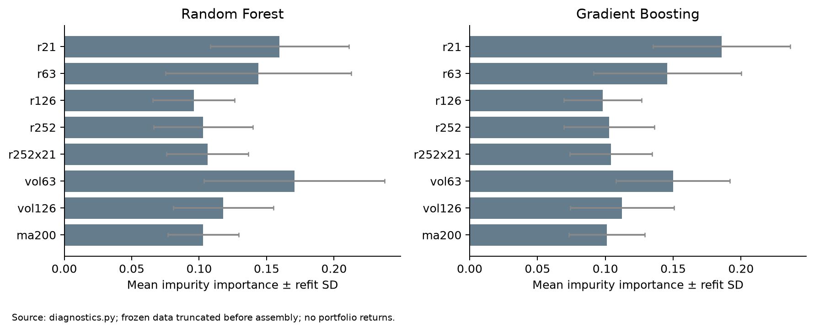
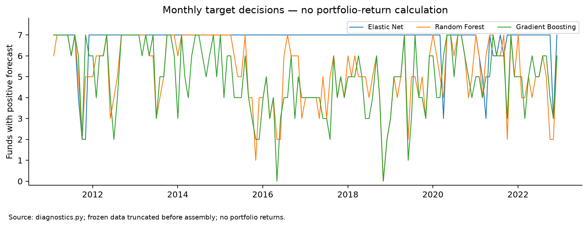
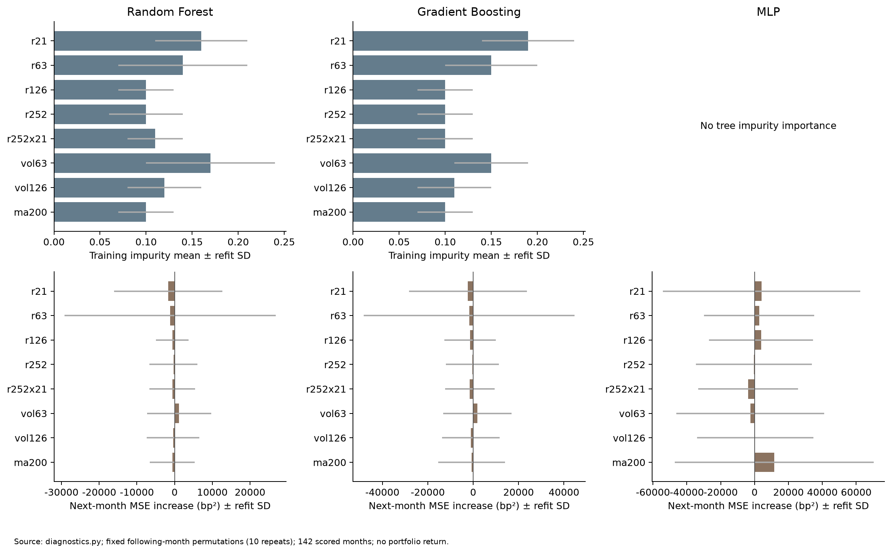

# Forecast diagnostic — in-sample only

I execute each unchanged ML strategy source and call its original forecasts() with the original settings. A passive observer records the fitted estimators. I use the lab market loader with a process-local raw-reader adapter that truncates every input frame before market assembly. No holdout observation enters features, fitting, labels or plots; no strategy return is computed.

Scored monthly decisions run from 2011-02-01 through 2022-11-01. December 2022 forecasts are included in fit and behaviour histories but not scored: their next decision is outside the truncated market. All models and the rule proxy use identical scored fund-months.

## Definitions and limits

For regression forecasts, R² vs zero = 1 − sum((actual − forecast)²) / sum(actual²), reported as a percentage. Sign hit rate compares positive forecasts with positive next-month excess returns. Monthly IC is Spearman rank correlation across the funds; constant forecasts have undefined IC and are excluded, not assigned zero. The IC t statistic uses Newey–West variance with a fixed lag of three valid IC observations after undefined months are omitted; for Elastic Net these need not be adjacent calendar months. These are post-run exploratory diagnostics, not a new gate or an independent confirmation.

The plain rule supplies a sign, not a calibrated monthly forecast. For the requested R² context I report a transparent mechanical proxy: trailing 252-session return over the bill divided by twelve. Its sign matches the rule exactly; its R² depends on that fixed scale and must not be interpreted as the rule’s forecast accuracy under an estimated model. Its rank IC uses the continuous signal, not tied binary holdings.

Per-fund rank correlation is a time-series Spearman correlation across that fund’s months; monthly cross-sectional IC and its t statistic are not defined for a single fund. Per-year IC averages the monthly cross-sectional correlations inside that year. Small yearly samples and serial dependence limit inference. I do not select models, years or funds using these diagnostics.

## Overall forecast quality

| Model | R² vs zero (%) | Monthly rank IC | IC t (HAC) | Valid IC months | Sign hit (%) | AUC | Log-loss | Observations |
|---|---:|---:|---:|---:|---:|---:|---:|---:|
| OLS | -6.77 | -0.06 | -1.26 | 142 | 50.40 | N/A | N/A | 994 |
| Elastic Net | -2.36 | 0.08 | 1.36 | 32 | 52.21 | N/A | N/A | 994 |
| Random Forest | -6.23 | -0.04 | -1.13 | 142 | 48.29 | N/A | N/A | 994 |
| Gradient Boosting | -13.08 | -0.05 | -1.23 | 142 | 46.38 | N/A | N/A | 994 |
| Logistic Regression* | n/a | -0.06 | -1.59 | 142 | 48.69 | 0.45 | 0.71 | 994 |
| MLP | -15.73 | -0.07 | -1.68 | 142 | 45.98 | N/A | N/A | 994 |
| Plain rule proxy | -8.03 | 0.06 | 1.13 | 142 | 52.41 | N/A | N/A | 994 |

*Return R² is n/a for logistic probabilities; accuracy, AUC and log-loss evaluate the classifier. IC uses probabilities against subsequent return ranks.

## Decision behaviour

| Model | Refits | Positive forecasts (%) | Adjacent sign changes (%) | Average funds held | Clustered decisions |
|---|---:|---:|---:|---:|---:|
| Elastic Net | 143 | 96.90 | 4.02 | 6.78 | 17 |
| Random Forest | 143 | 76.12 | 20.72 | 5.33 | 102 |
| Gradient Boosting | 143 | 71.23 | 29.88 | 4.99 | 122 |

## What the models learned

| Model | All-zero coefficient refits (%) | Adjacent importance-rank correlation | Same top feature (%) |
|---|---:|---:|---:|
| Elastic Net | 76.92 | 0.81 | N/A |
| Random Forest | N/A | 0.82 | 82.39 |
| Gradient Boosting | N/A | 0.79 | 69.01 |

Elastic Net coefficients are reported in basis points of forecast return per one training-window standard deviation of the feature. When every slope is zero, the forecast is only the fitted intercept: every fund then receives the same prediction. Changes in that pooled intercept’s sign can change the whole allocation together. The recomputed target histories reproduce the report’s clustered decision counts exactly. The diagnostic separates the number of refits from actual changes in target holdings.

Tree importances are impurity-based training diagnostics, not causal effects or out-of-sample predictive contributions. Means and standard deviations across refits and adjacent rank correlations describe their stability; correlated features can share or exchange importance.

## By year and by fund

The complete overall/year/fund table is forecast-metrics.csv. The fit-level records are fit-history.csv; decision-behaviour.csv and importance-stability.csv record the summaries. forecast-observations.csv stores individual forecasts and targets in basis points rounded to two decimals; metrics are computed before this display rounding.

### Year breakdown

| Model | Group | R² vs zero (%) | Rank IC | IC t | Sign hit (%) |
|---|---|---:|---:|---:|---:|
| Elastic Net | 2011 | -8.58 | 0.05 | N/A | 49.35 |
| Elastic Net | 2012 | 3.17 | N/A | N/A | 54.76 |
| Elastic Net | 2013 | -4.20 | -0.25 | N/A | 46.43 |
| Elastic Net | 2014 | -2.31 | 0.17 | 1.47 | 58.33 |
| Elastic Net | 2015 | -3.77 | N/A | N/A | 38.10 |
| Elastic Net | 2016 | 0.25 | N/A | N/A | 52.38 |
| Elastic Net | 2017 | 7.80 | 0.63 | N/A | 73.81 |
| Elastic Net | 2018 | -2.18 | 0.86 | N/A | 47.62 |
| Elastic Net | 2019 | 2.32 | N/A | N/A | 60.71 |
| Elastic Net | 2020 | 0.60 | -0.14 | N/A | 58.33 |
| Elastic Net | 2021 | 1.86 | 0.03 | 0.43 | 54.76 |
| Elastic Net | 2022 | -8.58 | 0.05 | 0.42 | 29.87 |
| Random Forest | 2011 | -11.41 | 0.11 | 1.21 | 49.35 |
| Random Forest | 2012 | -11.13 | -0.21 | -1.49 | 47.62 |
| Random Forest | 2013 | -12.37 | -0.13 | -1.93 | 45.24 |
| Random Forest | 2014 | -3.84 | -0.11 | -1.68 | 59.52 |
| Random Forest | 2015 | -3.71 | -0.11 | -2.31 | 45.24 |
| Random Forest | 2016 | -9.83 | -0.35 | -2.15 | 40.48 |
| Random Forest | 2017 | 9.16 | 0.19 | 3.69 | 55.95 |
| Random Forest | 2018 | -5.81 | -0.11 | -1.08 | 41.67 |
| Random Forest | 2019 | -2.15 | 0.00 | 0.02 | 44.05 |
| Random Forest | 2020 | 3.61 | 0.02 | 0.13 | 52.38 |
| Random Forest | 2021 | 2.14 | 0.06 | 0.53 | 52.38 |
| Random Forest | 2022 | -16.77 | 0.11 | 0.84 | 45.45 |
| Gradient Boosting | 2011 | -31.21 | 0.00 | 0.03 | 45.45 |
| Gradient Boosting | 2012 | -22.75 | -0.20 | -1.55 | 44.05 |
| Gradient Boosting | 2013 | -21.67 | -0.01 | -0.07 | 45.24 |
| Gradient Boosting | 2014 | -4.09 | -0.02 | -0.29 | 53.57 |
| Gradient Boosting | 2015 | -6.94 | -0.08 | -1.01 | 45.24 |
| Gradient Boosting | 2016 | -18.22 | -0.28 | -1.63 | 41.67 |
| Gradient Boosting | 2017 | -1.12 | 0.07 | 0.82 | 48.81 |
| Gradient Boosting | 2018 | -13.36 | -0.20 | -1.92 | 38.10 |
| Gradient Boosting | 2019 | -4.06 | -0.01 | -0.09 | 45.24 |
| Gradient Boosting | 2020 | 5.96 | 0.13 | 1.18 | 58.33 |
| Gradient Boosting | 2021 | -4.00 | -0.09 | -0.63 | 47.62 |
| Gradient Boosting | 2022 | -23.01 | 0.15 | 1.95 | 42.86 |
| Plain rule proxy | 2011 | -13.18 | 0.06 | 0.45 | 51.95 |
| Plain rule proxy | 2012 | -10.12 | -0.08 | -0.52 | 45.24 |
| Plain rule proxy | 2013 | 7.97 | 0.49 | 3.69 | 60.71 |
| Plain rule proxy | 2014 | -9.08 | 0.16 | 0.84 | 48.81 |
| Plain rule proxy | 2015 | 2.10 | 0.18 | 1.67 | 53.57 |
| Plain rule proxy | 2016 | -20.34 | -0.36 | -3.23 | 45.24 |
| Plain rule proxy | 2017 | 18.99 | 0.23 | 4.78 | 67.86 |
| Plain rule proxy | 2018 | -13.57 | -0.08 | -0.79 | 46.43 |
| Plain rule proxy | 2019 | -11.05 | -0.08 | -0.49 | 44.05 |
| Plain rule proxy | 2020 | -6.34 | -0.08 | -0.66 | 50.00 |
| Plain rule proxy | 2021 | -18.22 | 0.07 | 0.64 | 54.76 |
| Plain rule proxy | 2022 | -5.02 | 0.16 | 1.52 | 61.04 |
| OLS | 2011 | -7.30 | 0.08 | 0.86 | 53.25 |
| OLS | 2012 | -10.79 | -0.21 | -1.83 | 48.81 |
| OLS | 2013 | -8.83 | -0.29 | -1.70 | 48.81 |
| OLS | 2014 | -3.23 | -0.10 | -0.50 | 55.95 |
| OLS | 2015 | -5.07 | 0.07 | 0.72 | 51.19 |
| OLS | 2016 | -6.33 | -0.01 | -0.06 | 52.38 |
| OLS | 2017 | 3.55 | 0.28 | 2.78 | 55.95 |
| OLS | 2018 | -9.81 | -0.21 | -2.29 | 45.24 |
| OLS | 2019 | -3.72 | -0.26 | -2.12 | 48.81 |
| OLS | 2020 | -2.34 | -0.08 | -0.82 | 58.33 |
| OLS | 2021 | -4.75 | 0.04 | 0.32 | 47.62 |
| OLS | 2022 | -14.29 | 0.04 | 0.31 | 37.66 |
| Logistic Regression* | 2011 | n/a | -0.04 | -0.52 | 51.95 |
| Logistic Regression* | 2012 | n/a | -0.03 | -0.38 | 52.38 |
| Logistic Regression* | 2013 | n/a | -0.43 | -2.98 | 44.05 |
| Logistic Regression* | 2014 | n/a | -0.12 | -0.83 | 54.76 |
| Logistic Regression* | 2015 | n/a | 0.12 | 0.83 | 50.00 |
| Logistic Regression* | 2016 | n/a | -0.06 | -0.43 | 44.05 |
| Logistic Regression* | 2017 | n/a | 0.07 | 0.70 | 53.57 |
| Logistic Regression* | 2018 | n/a | -0.14 | -1.59 | 48.81 |
| Logistic Regression* | 2019 | n/a | -0.24 | -1.98 | 45.24 |
| Logistic Regression* | 2020 | n/a | 0.04 | 0.27 | 47.62 |
| Logistic Regression* | 2021 | n/a | -0.04 | -0.71 | 54.76 |
| Logistic Regression* | 2022 | n/a | 0.15 | 1.48 | 36.36 |
| MLP | 2011 | 1.53 | 0.22 | 4.34 | 59.74 |
| MLP | 2012 | -26.09 | -0.07 | -0.42 | 41.67 |
| MLP | 2013 | -21.16 | -0.31 | -2.48 | 40.48 |
| MLP | 2014 | -16.55 | -0.20 | -1.61 | 47.62 |
| MLP | 2015 | -21.01 | -0.21 | -1.97 | 41.67 |
| MLP | 2016 | -26.26 | -0.30 | -2.23 | 34.52 |
| MLP | 2017 | -4.59 | 0.10 | 0.82 | 55.95 |
| MLP | 2018 | -12.75 | -0.16 | -1.84 | 47.62 |
| MLP | 2019 | -17.11 | -0.22 | -1.69 | 39.29 |
| MLP | 2020 | -20.75 | 0.02 | 0.15 | 48.81 |
| MLP | 2021 | 4.13 | 0.23 | 3.55 | 57.14 |
| MLP | 2022 | -22.12 | 0.04 | 0.43 | 37.66 |

*Return R² is n/a for logistic probabilities; accuracy, AUC and log-loss evaluate the classifier.

### Fund breakdown

| Model | Group | R² vs zero (%) | Rank IC | IC t | Sign hit (%) |
|---|---|---:|---:|---:|---:|
| Elastic Net | DBC | -0.49 | 0.06 | N/A | 50.70 |
| Elastic Net | EEM | -4.82 | -0.13 | N/A | 47.89 |
| Elastic Net | EFA | -2.59 | -0.10 | N/A | 58.45 |
| Elastic Net | GLD | -3.64 | -0.21 | N/A | 42.25 |
| Elastic Net | IEF | -1.14 | 0.02 | N/A | 50.00 |
| Elastic Net | SPY | -1.32 | -0.12 | N/A | 66.90 |
| Elastic Net | TLT | -0.38 | -0.09 | N/A | 49.30 |
| Random Forest | DBC | -3.56 | 0.05 | N/A | 42.96 |
| Random Forest | EEM | -8.49 | -0.07 | N/A | 43.66 |
| Random Forest | EFA | -11.58 | -0.10 | N/A | 49.30 |
| Random Forest | GLD | -7.79 | -0.15 | N/A | 40.85 |
| Random Forest | IEF | 0.15 | 0.05 | N/A | 47.18 |
| Random Forest | SPY | -4.77 | -0.10 | N/A | 61.97 |
| Random Forest | TLT | -0.27 | 0.01 | N/A | 52.11 |
| Gradient Boosting | DBC | -8.37 | -0.04 | N/A | 41.55 |
| Gradient Boosting | EEM | -18.33 | -0.13 | N/A | 43.66 |
| Gradient Boosting | EFA | -23.07 | -0.12 | N/A | 50.00 |
| Gradient Boosting | GLD | -14.32 | -0.15 | N/A | 40.14 |
| Gradient Boosting | IEF | -7.12 | -0.02 | N/A | 47.18 |
| Gradient Boosting | SPY | -8.44 | -0.13 | N/A | 57.04 |
| Gradient Boosting | TLT | -3.11 | 0.01 | N/A | 45.07 |
| Plain rule proxy | DBC | -7.29 | 0.09 | N/A | 52.82 |
| Plain rule proxy | EEM | -10.45 | 0.00 | N/A | 51.41 |
| Plain rule proxy | EFA | -12.19 | -0.13 | N/A | 50.70 |
| Plain rule proxy | GLD | -5.70 | 0.02 | N/A | 49.30 |
| Plain rule proxy | IEF | -2.45 | 0.05 | N/A | 51.41 |
| Plain rule proxy | SPY | -5.41 | -0.13 | N/A | 64.79 |
| Plain rule proxy | TLT | -6.96 | -0.01 | N/A | 46.48 |
| OLS | DBC | -6.58 | -0.04 | N/A | 51.41 |
| OLS | EEM | -8.79 | -0.03 | N/A | 45.77 |
| OLS | EFA | -5.49 | -0.05 | N/A | 52.82 |
| OLS | GLD | -5.19 | -0.07 | N/A | 42.96 |
| OLS | IEF | 1.81 | 0.14 | N/A | 53.52 |
| OLS | SPY | -7.85 | -0.12 | N/A | 57.04 |
| OLS | TLT | -7.77 | -0.16 | N/A | 49.30 |
| Logistic Regression* | DBC | n/a | 0.10 | N/A | 52.11 |
| Logistic Regression* | EEM | n/a | -0.13 | N/A | 43.66 |
| Logistic Regression* | EFA | n/a | -0.15 | N/A | 53.52 |
| Logistic Regression* | GLD | n/a | -0.04 | N/A | 43.66 |
| Logistic Regression* | IEF | n/a | 0.10 | N/A | 45.77 |
| Logistic Regression* | SPY | n/a | -0.21 | N/A | 57.04 |
| Logistic Regression* | TLT | n/a | -0.23 | N/A | 45.07 |
| MLP | DBC | -14.50 | -0.07 | N/A | 41.55 |
| MLP | EEM | -17.98 | -0.09 | N/A | 50.70 |
| MLP | EFA | -12.84 | -0.10 | N/A | 45.77 |
| MLP | GLD | -12.66 | -0.06 | N/A | 49.30 |
| MLP | IEF | -30.28 | -0.13 | N/A | 42.25 |
| MLP | SPY | -15.03 | -0.05 | N/A | 48.59 |
| MLP | TLT | -19.76 | -0.13 | N/A | 43.66 |

*Return R² is n/a for logistic probabilities; accuracy, AUC and log-loss evaluate the classifier.

## Provenance

Source: diagnostics.py; the frozen data/manifest.json and its hash-verified snapshots; unchanged strategy.py in TM-017-06, TM-017-07 and TM-017-08. Source hashes, dates and scoring definitions are recorded in summary.json. No portfolio engine or lab.report run is invoked. The published holdout results of these completed cards were already seen before this diagnostic; no new holdout calculation is made.

## Fixed forecast extension and classification scale

OLS uses LinearRegression. Logistic regression uses L2, C=1.00 and max_iter=1000,
predicting the sign with a fixed probability boundary of 0.50. The MLP uses hidden
layers (16, 8), alpha=10^-3, early stopping, max_iter=500 and random_state=0.
All reuse the original eight features, completed labels, pooled 60-month window,
monthly dates, training-only scaling and bounded history. No setting is selected
from these results. The additional estimators produce forecasts only: no positions,
portfolio return, strategy card, gate verdict or registry entry is created.

The classifier's R² is displayed as n/a. Its rank IC uses probabilities
against subsequent excess-return ranks; accuracy, AUC and log-loss evaluate signs.
No probability-to-return calibration is invented. Regression and rule-proxy R²
definitions, all original metric rows and original decision histories are retained.

Permutation importance is the increase in following-month MSE when a feature is
permuted, in return basis points squared, with ten repeats and random_state=0.
The estimator and training scaler are frozen before that month's seven outcomes
are scored. Each date uses only the next completed month inside the cutoff; there
are 142 scored refits. The mean is across monthly importance estimates, with
refit dispersion shown separately. Negative importance means shuffling improved
that month's error. These small, correlated cross-sections do not identify causes.
Training impurity importances use the original 143 refits, including unscored
December 2022. The MLP has no tree impurity importance.

The MLP's early-stopping validation is internal to historical training data, not
the next evaluation month, but it is not a separate chronological inner split.
Convergence warnings are recorded in summary.json without changing settings.

Provenance: diagnostics.py, forecast-metrics.csv, extended-forecast-observations.csv,
permutation-importances.csv, permutation-summary.csv and impurity-summary.csv.
Original forecast-observations.csv, fit-history.csv, decision-behaviour.csv and
importance-stability.csv remain unchanged. New metrics are computed before
two-decimal display rounding. No holdout or portfolio return is evaluated.

## Following-month permutation summary

| Model | Feature | Mean MSE increase (bp²) | Refit SD (bp²) | Months |
|---|---|---:|---:|---:|
| MLP | r21 | 4096.62 | 58294.97 | 142 |
| MLP | r63 | 2647.91 | 32630.47 | 142 |
| MLP | r126 | 3784.76 | 30646.43 | 142 |
| MLP | r252 | -357.65 | 34268.15 | 142 |
| MLP | r252x21 | -3846.08 | 29435.92 | 142 |
| MLP | vol63 | -2504.31 | 43662.73 | 142 |
| MLP | vol126 | 360.40 | 34283.35 | 142 |
| MLP | ma200 | 11588.77 | 58803.16 | 142 |
| Random Forest | r21 | -1741.79 | 14365.20 | 142 |
| Random Forest | r63 | -1212.85 | 27982.90 | 142 |
| Random Forest | r126 | -623.33 | 4291.16 | 142 |
| Random Forest | r252 | -307.55 | 6359.59 | 142 |
| Random Forest | r252x21 | -613.37 | 6083.30 | 142 |
| Random Forest | vol63 | 1173.36 | 8497.97 | 142 |
| Random Forest | vol126 | -388.12 | 6972.01 | 142 |
| Random Forest | ma200 | -604.42 | 5978.30 | 142 |
| Gradient Boosting | r21 | -2340.01 | 25979.68 | 142 |
| Gradient Boosting | r63 | -1762.01 | 46491.07 | 142 |
| Gradient Boosting | r126 | -1348.40 | 11402.61 | 142 |
| Gradient Boosting | r252 | -353.13 | 11709.17 | 142 |
| Gradient Boosting | r252x21 | -1469.00 | 10850.39 | 142 |
| Gradient Boosting | vol63 | 1822.32 | 15067.99 | 142 |
| Gradient Boosting | vol126 | -1080.45 | 12713.25 | 142 |
| Gradient Boosting | ma200 | -750.57 | 14735.81 | 142 |

For both tree ensembles, vol63 is the only feature with positive mean permutation importance; most training-important features have negative following-month importance. The MLP has mixed signs and its largest positive mean is ma200. Refit dispersion is large relative to these means. Positive importance for one input does not validate the complete model, whose return R² remains negative. Source: permutation-summary.csv; every feature and month is retained.
