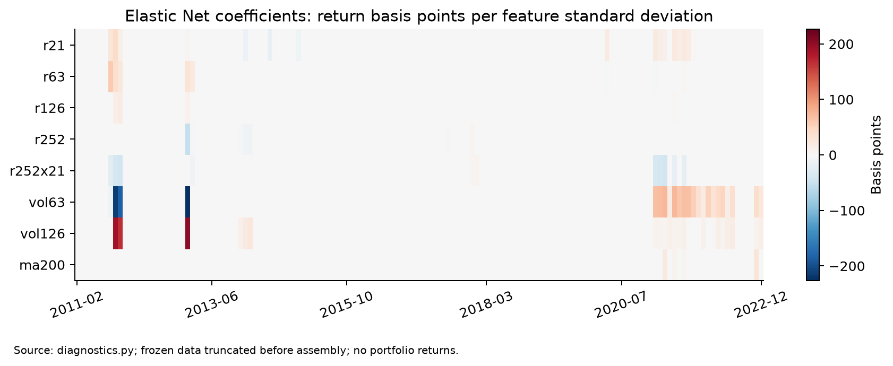
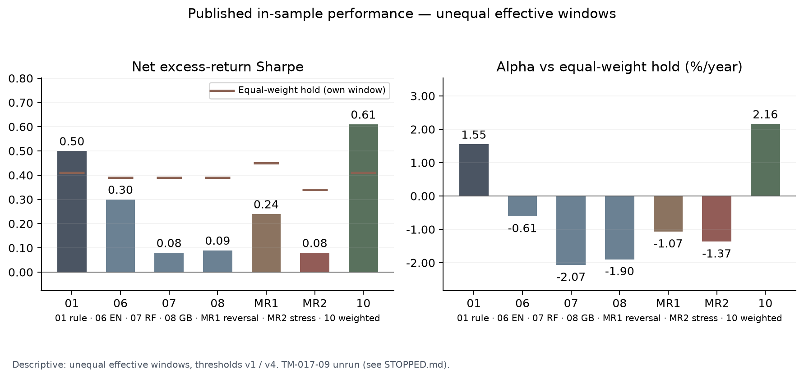
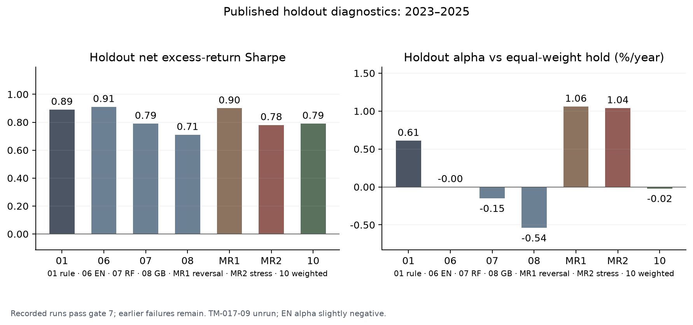

# Do machine-learning trend signals survive strict validation?

Anas Chantah — Master in Finance, IE Business School

AI for Finance — Individual capstone

## Abstract

I build a forecasting layer on Alpha Factory and ask whether ML signals survive where a fixed trend rule fails. The original Elastic Net, Random Forest and Gradient Boosting cards fail validation. I extend their pre-2023 forecast diagnostic with fixed OLS, logistic regression and a small neural network. Return-forecast accuracy remains weak; the classifier also gives weak sign discrimination. Following-month permutation importance often contradicts training impurity importance. Two reversal follow-ups fail economic edge. A volatility-weighted specification is skipped before any run, then repaired only through a new user-fixed card. The repaired TM-017-10 passes economic edge and robustness but first fails significance. I preserve every trial and the unrun specification, distinguishing forecast evaluation from portfolio validation. Earlier holdout exposure, accumulated testing and the missing historical reference commit prevent stronger confirmatory or paired-performance claims.

## 1 Introduction

My research question is: do ML signals survive strict out-of-sample validation where rule-based strategies fail? I translate an economic mechanism into forecasts and positions, then apply a fixed validation battery.

The starting point is Alpha Factory's published time-series momentum strategy, TM-017-01. It holds a fund when its trailing return exceeds the Treasury-bill return and otherwise leaves that allocation in cash. Its published in-sample Sharpe is 0.50, against 0.41 for equal-weight holding, with annual alpha of 1.55%. It nevertheless fails significance: it beats 81.70% of shifted-weight placebos, below the required 90.00%. This distinction between a favourable summary statistic and a validated effect motivates my experiment.

I replace fixed entry decisions with learned forecasts while retaining the funds, monthly schedule and allocation. Elastic Net regularises a linear mapping; the ensembles allow nonlinear relationships. I test whether these price descriptions improve entry timing without assuming that flexibility creates investment value.

After the original failures, I diagnose forecasts on development-era data without changing settings or computing portfolio returns. I then pre-specify unconditional reversal, stress-conditioned reversal and volatility-weighted trend, preserving the skipped specification and its separately locked repair.

## 2 Literature

Moskowitz, Ooi and Pedersen (2012) motivate the original economic mechanism. Time-series momentum uses an instrument's own past return to predict its subsequent direction. It differs from cross-sectional momentum, which ranks instruments against one another. Slow information absorption, gradual institutional reallocations and delayed responses to common news can generate continuation. My ETF application uses this own-history perspective, but it does not replicate the paper's futures universe, short positions, leverage or risk scaling. Those implementation differences limit direct comparison with the academic evidence.

Gu, Kelly and Xiu (2020) motivate flexible prediction methods and the forecast-evaluation perspective. Models can represent interactions and nonlinearities that a fixed linear relationship misses. I apply that idea to a much smaller setting: fund-level price histories rather than a rich panel of security characteristics. Their results do not establish an expected Sharpe for my application. I adopt R² relative to a zero-return forecast as a diagnostic because it asks whether prediction improves squared-error accuracy over a transparent benchmark. A negative value identifies failure on that criterion even when some predicted signs are correct.

Harvey, Liu and Zhu (2016) address the consequences of extensive testing in finance. Searching through many explanations makes a selected historical result less persuasive. Alpha Factory addresses this problem with locked hypothesis cards and a registry that retains completed trials. I use those controls to separate a new hypothesis from a revision selected after observing its own performance. A modest search budget does not remove all researcher discretion, but it makes the sequence visible and prevents unlimited attempts from disappearing behind a reported winner.

Bailey and López de Prado (2014) provide a related basis for correcting selected backtest performance. The framework reports a deflated Sharpe diagnostic on benchmark-hedged returns and accounts for accumulated trials. I retain the framework's recorded judgments rather than recalculating a more favourable selection adjustment. This matters because the original ML models enter a registry containing earlier research, while the historical reference entered under a different trial history. Their gate outcomes are informative records, not a controlled experiment under identical historical conditions.

For the follow-up, I use the liquidity-provision interpretation of short-term reversal documented in the lab's MR-001 theory file, including Nagel (2012). Selling pressure can create a temporary price concession that compensates a patient buyer for inventory and adverse-selection risk. This mechanism differs from intermediate-horizon trend continuation. I test a coarse implication after recent declines; I do not observe dealer inventories or identify liquidity-motivated orders. The literature supplies an economic reason for the hypothesis, not proof that it survives on these liquid funds.

## 3 Data

I use SPY, EFA, EEM, IEF, TLT, GLD and DBC, matching the published reference and original ML cards. These funds cover equities, Treasury bonds, gold and commodities. I hold the asset set constant across completed strategies. Exposures remain correlated: separate Treasury funds are not independent economic experiments.

The lab reports identify daily closes adjusted for dividends and splits from snapshot 2026-09-22 and addition 2026-09-23. The manifest records the original Yahoo Finance data source. I work from that frozen local snapshot; I do not refresh or download observations. The declared period is 2005–2025, with 2005–2022 assigned to in-sample evaluation and 2023–2025 to the framework's sealed holdout. Freezing the data vintage supports traceability, but it does not eliminate measurement limitations in adjusted historical prices.

Effective performance windows differ. The reference report starts on 2006-02-01; the ML reports start on 2011-02-02 after feature history and the initial estimation window are available. The unconditional reversal report starts on 2005-03-02, the stress-conditioned report on 2008-05-02 and TM-017-10 on 2006-02-02. All finish their in-sample evaluation on 2022-12-30. Each report's passive benchmark is evaluated on its own effective window. I preserve those dates rather than implying that the shared declared split makes every Sharpe directly comparable.

For the forecast diagnostic, I truncate every raw input frame at 2022-12-31 before the lab constructs the market. This prevents even ancillary market calculations from using holdout observations. The common scored sample contains 994 fund-month observations over 142 monthly decisions, from February 2011 through November 2022. December 2022 forecasts remain in the coefficient and decision histories, but I do not score their labels because the next decision lies outside the truncated market. No diagnostic feature, forecast or target uses a later observation.

The financial reports use excess returns over the Treasury bill, net of the lab's transaction costs. Their benchmark holds the same funds permanently in equal parts. Alpha is the annual intercept from regressing strategy excess returns on benchmark excess returns. It measures benchmark-relative value after adjusting for exposure; it is neither a raw total-return subtraction nor alpha against TM-017-01.

## 4 Method

### 4.1 Original ML application

I use eight features from each fund's own lagged closes: returns over 21, 63, 126 and 252 sessions; momentum from 252 to 21 sessions before the decision; annualised volatility over 63 and 126 sessions; and the latest close divided by its 200-session moving average, less one. The features end at the session before the monthly decision. Overlapping horizons offer related descriptions of price behaviour rather than independent information sources.

The target is the fund's return from the pre-decision close to the close before the next monthly decision, less the compounded bill return over that interval. I pool available fund-months and refit on the most recent 60 completed months. Standardisation uses the rolling estimation window, and target scaling is reversed after prediction. A training label enters only after it is known. This creates chronological forecasts inside the framework's in-sample era as well as during its final holdout.

Each tradable fund with a positive forecast receives one seventh of the portfolio; its share otherwise remains in cash. Forecast magnitude does not change position size, and funds are not ranked for allocation. The model refits on the first session of each month and holds between decisions. Memory is bounded at 2,400 sessions. The robustness windows are 30, 45, 75 and 90 months, rather than alternatives selected after their returns are inspected.

Elastic Net uses ElasticNetCV with L1 shares 0.10, 0.50 and 0.90, and a fixed grid of 20 logarithmically spaced penalties from 10^-4 to 1. TimeSeriesSplit supplies three internal splits. The grid and selection procedure are fixed, while the chosen penalty changes within rolling estimation. Random Forest uses 200 trees, depth 3, at least 20 observations per leaf, feature fraction 0.50 and random state 0. Gradient Boosting uses 150 trees, depth 2, learning rate 0.03, subsampling 0.70, at least 20 observations per leaf and random state 0.

### 4.2 Validation battery

I preserve the lab's seven gates and define each strategy's verdict as its first failure. The lab evaluates later gates even after an earlier failure. A later pass therefore adds a diagnostic observation; it does not reverse the verdict. Table 1 summarises the current battery used for the ML and reversal cards. The historical reference records threshold version 1, while these later cards record version 4.

Table 1. Validation gates and current thresholds.

| Gate | What it tests | Threshold or requirement |
|---|---|---|
| 1 — Hygiene | Information timing, memory, data and evidence count | No timing, memory or data break; at least 30 clustered decisions and 5 evaluated years for these funds |
| 2 — Economic edge | Useful net return beyond passive exposure and costs | Sharpe at least 0.40 and at least the benchmark; alpha positive; doubled-cost Sharpe at least 0.30 and alpha positive; cost burden at most one third of gross Sharpe |
| 3 — Significance | Evidence beyond chance timing | PSR at least 0.95; at least 90.00% of 1,000 shifted placebos beaten |
| 4 — Multiple testing | Selection from accumulated trials | DSR at least 0.90 after the registry-based adjustment |
| 5 — Stability | Dependence on a variant or episode | Blend passes gates 2–4; worst variant Sharpe positive; positive alpha in at least 3 of 5 blocks and after removing the best year |
| 6 — Robustness | Parameter peaks, concentration, cluster dependence and timing | Median neighbour retention at least 70.00%; nearby and cluster retention at least 50.00%; single-asset profit share at most 30.00%; delay retention at least 70.00%; survivor correlation at most 0.70 when applicable |
| 7 — Sealed holdout | Chronology and severe performance decay | Holdout Sharpe and alpha at or above their in-sample 10th-percentile floors; no rewritten positions, timing break or data problem |

The diagnostic extension uses LinearRegression for OLS; LogisticRegression with L2, C=1.00 and max_iter=1000 for the return sign; and MLPRegressor with layers (16, 8), alpha=10^-3, early stopping, max_iter=500 and random_state=0. All retain the same features, pooling, completed labels, rolling window and training scaling. These additional estimators generate forecasts only, with no positions, portfolio return or registered trial. No setting is tuned to the diagnostic.

The clustered count measures episodes of changed targets, not simply monthly refits. Reissuing the same target does not automatically create another decision. The placebo construction shifts the strategy's own weights in time. Its beaten percentage is not a conventional p-value. The holdout floors are lower-tail diagnostics derived from in-sample paths, not a requirement for positive alpha. These definitions explain several results below.

### 4.3 Forecast diagnostic and follow-up design

I execute each original strategy source unchanged and observe the estimators returned by its fitting function. I calculate R² as one minus forecast squared error divided by the squared error of a zero forecast. Monthly IC is the cross-sectional Spearman correlation between forecasts and subsequent fund returns; I average valid monthly correlations and report a Newey–West t statistic with a fixed lag of three valid monthly observations. Undefined months are omitted, so Elastic Net’s lags need not span consecutive calendar months. Constant forecasts have undefined IC and are excluded, not assigned zero. Per-fund rank correlations instead describe the time-series relationship within that fund.

The plain rule produces a sign rather than a calibrated monthly return forecast. For R² context only, I divide its trailing 252-session excess return by twelve. This fixed mechanical proxy preserves its entry sign, but its R² depends on that scale. I do not present it as an estimated forecast or the rule's portfolio return. Its continuous signal supplies the rank correlation, avoiding the ties created by binary holdings.

After the diagnostic, I first draw MR-001-01. On each monthly decision it buys a fund when its trailing 21-session return falls below the bill over the same interval. Each qualifying fund receives one seventh; other shares remain cash. The conventional monthly horizon and zero excess-return boundary are fixed without testing this strategy's return. The prescribed neighbours are 16 and 26 sessions, then 10 and 32; memory is 32. There is one base variant and no fitted coefficient, volatility filter or selected threshold.

For that first follow-up, I commit the card alone before its code, validate targets without returns, and run it once. I then commit its registry entry alone before its report. I disclose that the earlier holdout results were already known. The design uses only the in-sample diagnostic and literature, but the calendar holdout cannot become globally unseen again. This follow-up is an exploratory test, not an untouched independent confirmation.

## 5 Results

### 5.1 Original strategies and published reference

Table 2 transcribes the published base metrics. Every alpha is against passive equal-weight holding on that report's effective window. I supply no paired performance difference or significance claim about which strategy is superior. The original ML cards fail before the historical rule: Elastic Net at gate 1, Random Forest and Gradient Boosting at gate 2, versus gate 3 for the rule.

Table 2. Published strategy outcomes; unequal effective in-sample windows.

| Strategy | First failed gate | IS Sharpe | Alpha (%/year) | Placebos beaten (%) | Holdout Sharpe | Holdout alpha (%/year) |
|---|---|---:|---:|---:|---:|---:|
| TM-017-01 — Plain rule | 3 | 0.50 | 1.55 | 81.70 | 0.89 | 0.61 |
| TM-017-06 — Elastic Net | 1 | 0.30 | -0.61 | 0.00 | 0.91 | -0.00 |
| TM-017-07 — Random Forest | 2 | 0.08 | -2.07 | 0.90 | 0.79 | -0.15 |
| TM-017-08 — Gradient Boosting | 2 | 0.09 | -1.90 | 1.80 | 0.71 | -0.54 |
| MR-001-01 — Liquidity reversal | 2 | 0.24 | -1.07 | 37.10 | 0.90 | 1.06 |
| MR-001-02 — Stress reversal | 2 | 0.08 | -1.37 | 33.70 | 0.78 | 1.04 |
| TM-017-09 — Volatility-weighted trend | Not run | — | — | — | — | — |
| TM-017-10 — Repaired weighted trend | 3 | 0.61 | 2.16 | 89.80 | 0.79 | -0.02 |

Elastic Net produces 17 clustered decisions against 30 required. Its sampled timing and memory checks find no breach, so its first failure is insufficient distinct decision evidence. Its negative alpha and low placebo rank also fail later requirements. The ensembles pass hygiene with 102 and 122 decisions, but their negative alphas and low Sharpes fail economic edge. All original ML cards additionally fail significance, multiple testing, stability and robustness. A complex model therefore does not merely lose at a demanding final correction; its published economic evidence is already unfavourable.

### 5.2 What the forecast diagnostic reveals

Table 3 compares six fixed learners and the rule proxy on identical scored observations. Every regression model has negative return R². The classifier has negative return-rank IC and weak sign metrics. Elastic Net's positive IC uses only 32 valid months because its forecasts often tie across funds; the other comparisons retain 142 months. These exploratory statistics do not replace portfolio gates.

Table 3. Pre-2023 forecast evaluation; classifier R² is not reported.

| Model | R² vs zero (%) | Rank IC | IC t | IC months | Sign hit (%) | AUC | Log-loss |
|---|---:|---:|---:|---:|---:|---:|---:|
| OLS | -6.77 | -0.06 | -1.26 | 142 | 50.40 | — | — |
| Elastic Net | -2.36 | 0.08 | 1.36 | 32 | 52.21 | — | — |
| Random Forest | -6.23 | -0.04 | -1.13 | 142 | 48.29 | — | — |
| Gradient Boosting | -13.08 | -0.05 | -1.23 | 142 | 46.38 | — | — |
| Logistic Regression* | n/a | -0.06 | -1.59 | 142 | 48.69 | 0.45 | 0.71 |
| MLP | -15.73 | -0.07 | -1.68 | 142 | 45.98 | — | — |
| Plain rule proxy | -8.03 | 0.06 | 1.13 | 142 | 52.41 | — | — |

*R² is not defined for a binary target; the logistic model is judged by accuracy, AUC and log-loss. Its IC uses probabilities against subsequent return ranks; its sign threshold is 0.50. No probability-to-return calibration is invented.

Elastic Net removes every slope in 76.92% of 143 monthly fits. Its prediction then reduces to the pooled intercept, giving each fund the same expected excess return. Across the decision history, 96.90% of forecasts are positive, it holds an average of 6.78 funds, and adjacent fund-level signs change only 4.02% of the time. Recomputing its target history reproduces the lab's 17 clustered decisions exactly. Repeated refitting therefore did not create correspondingly distinct investment decisions.

Random Forest holds an average of 5.33 funds, with adjacent sign changes of 20.72%; Gradient Boosting holds 4.99 with changes of 29.88%. Their adjacent importance-rank correlations are 0.82 and 0.79. Their persistent training importances do not imply forecast skill. Following-month permutation importance is the MSE increase after shuffling a feature, in return basis points squared, averaged over refits with ten repeats and random_state=0. For both ensembles, vol63 is the only feature with positive mean importance; most others are negative. The MLP has mixed signs and large refit dispersion. No feature subset or revised model is selected from these findings.

### 5.3 New hypothesis and recorded outcome

The new reversal card passes hygiene with 205 clustered decisions, no sampled timing or memory breaks and 17.83 evaluated years. It first fails economic edge: Sharpe is 0.24 against benchmark 0.45, and annual alpha is -1.07%. Doubled costs reduce Sharpe to 0.21 and alpha to -1.36%. The rule beats 37.10% of shifted placebos and has PSR 0.87, below the significance requirements. Its DSR is below 0.01 across 79 effective trials in a registry containing 86 trials.

Stability fails because only two calendar blocks have positive alpha and removing its best year leaves alpha -1.63%. Robustness also fails: GLD accounts for 32.88% of profit, above the allowed concentration. The holdout passes with Sharpe 0.90 and annual alpha 1.06%. I retain this failure without changing the rule or promoting its favourable holdout into validation. Later specifications are separately locked.

### 5.4 The holdout paradox

Elastic Net's holdout Sharpe of 0.91 exceeds the rule's 0.89 descriptively, yet its alpha rounds to -0.00%, while the rule's is 0.61%. This is not a contradiction. Sharpe measures excess return relative to volatility; regression alpha measures value added beyond passive benchmark exposure. A largely invested strategy can achieve a positive Sharpe without adding alpha. Elastic Net's displayed alpha is slightly negative before rounding. Passing the holdout gate only means that its outcome exceeds its in-sample-derived lower floors and passes the associated chronology checks.

The same reasoning applies to the new rule's positive holdout alpha. It is a published result worth reporting, but it cannot offset a locked economic failure. I use the lab's recorded holdout outputs for these descriptions and compute no additional holdout forecast or return outside its runs.

### 5.5 Further pre-specified follow-ups and the repair

I fixed both further rules before either ran, as capstone follow-ups 2 and 3. MR-001-02 activates reversal when SPY's 63-session realised volatility exceeds the median of its preceding 756 volatility observations. Those windows are fixed; only the return lookback and its prescribed neighbours vary. Memory is 830 sessions. The card passes hygiene with 92 clustered decisions, but fails gate 2: Sharpe 0.08 against benchmark 0.34, annual alpha -1.37% and 33.70% of shifted placebos beaten. GLD supplies 84.15% of profit, and a nearby parameter produces negative Sharpe retention. Its holdout passes with Sharpe 0.78 and alpha 1.04%. Stress conditioning does not validate this implementation; different effective windows prevent a paired improvement claim against unconditional reversal.

TM-017-09 retains the 252-session entry rule and uses inverse 63-session volatility slots, normalised over all tradable funds, held or not, with memory 400. Its official preflight encounters an undefined denominator on 2006-03-01: DBC is tradable but lacks the full volatility history. Dropping that fund, imputing its volatility or changing the start would alter the user-fixed rule. I therefore skip its real run. TM-017-09 remains skipped at preflight, repaired only by the new TM-017-10; no result from 09 exists.

That stage adds only MR-001-02, whose report records 87 trials and 80 effective trials. I subsequently fix TM-017-10 with parent=null and one repair: funds with undefined 63-session volatility are not held or included in the denominator. The 252-session entry, fixed volatility window, prescribed neighbours and memory 400 remain unchanged.

TM-017-10 passes hygiene with 203 clustered decisions. Its Sharpe is 0.61 against benchmark 0.41 and annual alpha 2.16%; gate 6 passes, with SPY's largest profit share 28.55%. It first fails gate 3 at 89.80% of placebos beaten against 90.00% required. DSR is 0.27 across 81 effective trials from 88 trials, and the blend fails stability. Holdout Sharpe is 0.79 with alpha -0.02%. I retain the improved recorded economics and robustness alongside the rejection, without a paired improvement claim.

Four follow-up cards are specified overall; three have financial trials and 09 remains unrun. Each registered trial raises the selection burden. The forecast-only extension adds no portfolio trial or gate verdict.

## 6 Discussion

The cycle now separates model failure, diagnosis and a repaired unrun specification from tuning a completed strategy. The fixed OLS baseline shows that weak return accuracy is not unique to Elastic Net shrinkage. Direct sign prediction and a nonlinear network also provide weak forecast evidence.

The first follow-up replaces an estimated pooled mean with an economically motivated decline condition. Its failure does not identify why the ML models fail, because the estimator and economic hypothesis both change. I do not generalise that rejection to all simple models or liquidity-reversal strategies.

Nagel (2012) reports that reversal strategies formed on diversified industry portfolios earn little unconditionally and become profitable mainly when the VIX is high. MR-001-01 trades diversified ETFs without conditioning on volatility, so its failure is consistent with that evidence rather than contrary to it. The later stress rule uses realised SPY volatility rather than VIX; its failure does not reject every liquidity-state hypothesis. TM-017-09 supplies no financial evidence. Its separately locked repair passes the concentration criterion but not significance or multiple testing; a favourable sizing result is not full validation.

The permutation importances show 63-session volatility as the only feature with positive mean importance for both tree models, while TM-017-10, the best-performing strategy by recorded in-sample Sharpe, uses volatility for weighting rather than prediction. This is consistent but not causal evidence, since TM-017-10 was specified before the extended diagnostic.

TM-017-10 misses gate 3 by 0.20 percentage points (89.80% versus 90.00%), but also fails gate 4 (DSR 0.27 versus 0.90), so it is not a near-pass. Re-running or adjusting it would be the data snooping that the framework is built to prevent.

The evidence separates three objects that can otherwise be confused: learning behaviour, forecast quality and portfolio performance. Coefficients and impurity importances describe fitted relationships. R² and IC compare predictions with later fund outcomes. The gates judge an implemented portfolio, including costs, exposure, dependence and selection. A persistent importance ranking can coexist with negative forecast R²; a positive Sharpe can coexist with negative alpha; a favourable holdout can coexist with an overall rejection. My application makes these distinctions observable.

A negative result remains useful without a winner. I preserve all four follow-up specifications, including the skipped card, and stop at the user-fixed scope. The contribution is an inspectable research application and a documented rejection of the tested investment propositions.

## 7 Limitations

The official paired comparison cannot authenticate TM-017-01 because commit 9a00fbb is absent from the squashed history. I do not replace its test. Different effective windows and threshold versions prevent a common-window performance effect, its standard error or statistical superiority from being inferred from the headline table.

The universe has only seven funds. Correlated assets and overlapping price features limit the independent information available to a pooled estimator. The application also differs from broader momentum studies in instruments, leverage and allocation. I do not observe the order flow required to identify liquidity provision in the follow-up. Buying after a decline can capture fundamental deterioration as well as temporary pressure. The new rule therefore tests an implementation, not a clean causal decomposition of a price move.

Elastic Net standardises over the whole outer training window before its internal cross-validation. The scaler is not refitted within each inner fold, and pooled row boundaries need not keep all funds from a month together. This weakens the interpretation of internal selection even though current forecasts use completed historical months. The diagnostic also records 15 convergence warnings. The MLP also uses an internal random early-stopping split inside the historical window, rather than a chronological inner validation. I disclose these limitations without modifying a finished card. The target uses pre-decision closes, while execution follows the lab's trading convention, creating another difference between forecast labels and realised investment returns.

The diagnostic is exploratory and follows observed failures. Its IC statistics use small cross-sections, and Elastic Net's valid IC months are a selected subset where forecasts vary. Per-fund rank correlations answer a different question from monthly cross-sectional IC. The rule proxy's R² depends on a mechanical scaling convention; logistic R² is reported as n/a. Permutations use small following-month cross-sections with correlated features, so signed importance is unstable and not causal. I report these definitions so that descriptive diagnostics are not mistaken for an independently specified significance test or a clean ranking of every signal.

Cards TM-017-03 to TM-017-05 were retired unrun after an administrative locking error; TM-017-06 to TM-017-08 retain their hypotheses. I report both sets rather than hiding the earlier identifiers. I saw the completed 06–08 holdouts before MR-001-01, and its holdout before I fixed the two later rules. There are four follow-up cards, three executed and one skipped; TM-017-10 repairs an unrun specification after earlier holdouts were seen. Each additional registered trial raises the selection burden rather than providing a free attempt. Protecting subsequent design from new holdout calculations does not restore ignorance of earlier outputs; pre-specification alone cannot make this sequential research independently confirmatory.

## 8 Conclusion

The original ML strategies do not survive validation, and the fixed extension shows weak forecast evidence across regression and classification. The extension has no portfolio verdict. Both reversal follow-ups fail economic edge. TM-017-09 stays unrun; its repaired successor clears economics and robustness but first fails significance and also fails multiple testing. I retain that qualified progress without changing the cutoff or searching for another card. The contribution is a working application that distinguishes forecasts, investment value and cumulative validation, preserves failed and unrun specifications, and discloses prior holdout exposure.

## References

Bailey, D. H., and López de Prado, M. (2014). The Deflated Sharpe Ratio: Correcting for Selection Bias, Backtest Overfitting, and Non-Normality. The Journal of Portfolio Management, 40(5), 94–107.

Gu, S., Kelly, B., and Xiu, D. (2020). Empirical Asset Pricing via Machine Learning. The Review of Financial Studies, 33(5), 2223–2273.

Harvey, C. R., Liu, Y., and Zhu, H. (2016). … and the Cross-Section of Expected Returns. The Review of Financial Studies, 29(1), 5–68.

Moskowitz, T. J., Ooi, Y. H., and Pedersen, L. H. (2012). Time Series Momentum. Journal of Financial Economics, 104(2), 228–250.

Nagel, S. (2012). Evaporating Liquidity. The Review of Financial Studies, 25(7), 2005–2039.

## Prior work and disclosure

Alpha Factory is a pre-existing framework I co-founded with Sami Andaloussi before the course, used here only as an evaluation tool (https://github.com/Sami-Andaloussi/alpha-factory). My contribution for this course is the ML layer, the diagnostic, the new hypotheses, the experiments and the analysis, all committed under my name. I used generative AI tools (Claude, OpenAI Codex) for coding and drafting, in line with the course's GenAI policy; I reviewed and take responsibility for all content.
