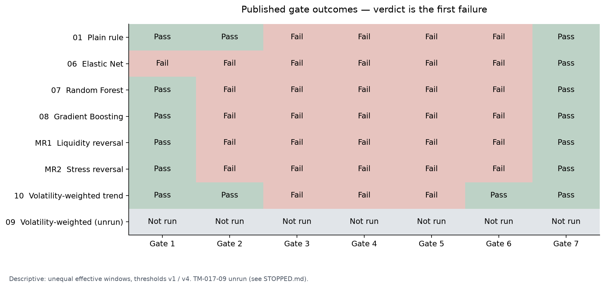
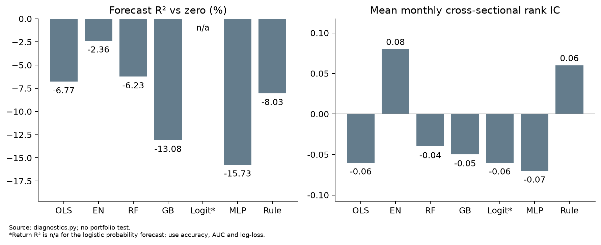
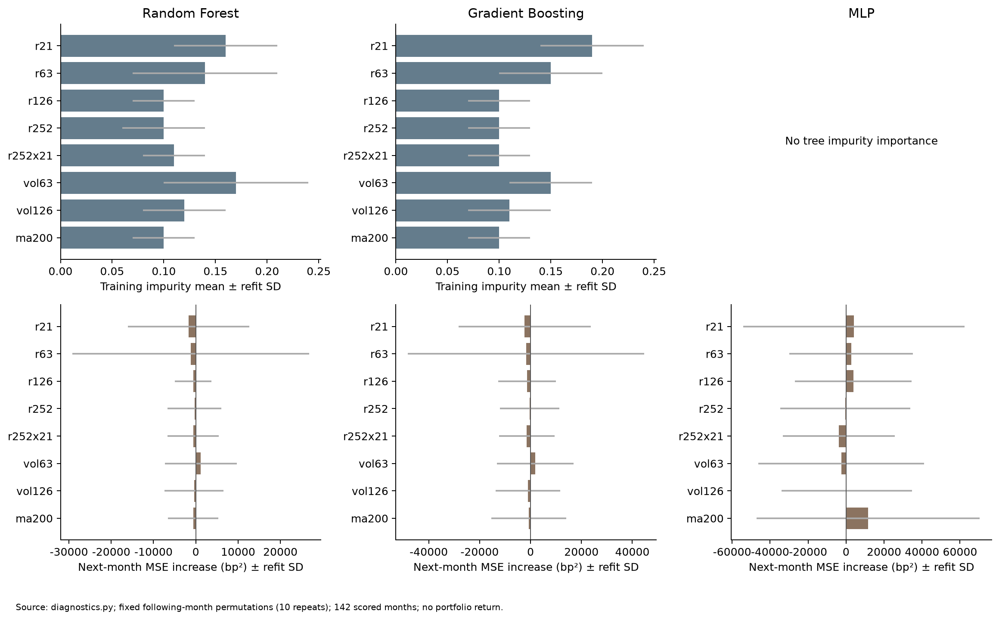

# Do machine-learning trend signals survive strict validation?

Anas Chantah — Master in Finance, IE Business School

AI for Finance — Individual capstone (Type A: free application)

## Abstract

A published time-series momentum rule on seven liquid ETFs earns a higher in-sample Sharpe ratio than equal-weight holding (0.50 versus 0.41) and 1.55% annual alpha, yet fails significance: it beats 81.70% of shifted-timing placebos against 90.00% required. I ask whether machine-learning forecasts can turn this monthly entry decision into a validated improvement net of costs. Elastic Net, Random Forest and Gradient Boosting forecast each fund's next-month excess return from eight lagged price features, refitted monthly on a rolling 60-month window; a fund is held when its forecast is positive. The data are daily adjusted closes for SPY, EFA, EEM, IEF, TLT, GLD and DBC from a frozen Yahoo Finance snapshot, with 2005–2022 in-sample and 2023–2025 evaluated once per strategy as a reserved holdout. All three ML strategies fail a seven-gate validation battery, with Sharpe ratios of 0.30, 0.08 and 0.09 and annual alphas of -0.61%, -2.07% and -1.90%. A pre-2023 diagnostic of six fixed learners finds negative R² against a zero forecast for every return model (-2.36% to -15.73%) and an AUC of 0.45 for a logistic classifier. Of three executed economic follow-ups, a volatility-weighted trend rule performs best (Sharpe 0.61, alpha 2.16%) but fails significance (89.80% of placebos beaten) and multiple testing (deflated Sharpe 0.27 against 0.90). No tested strategy is fit for deployment.

## 1 Introduction and Business Problem

Consider a multi-asset allocator who holds seven liquid ETFs in equal sleeves and decides each month whether every sleeve is invested or parked in Treasury bills. A trend overlay is the standard way to make that decision. Moskowitz, Ooi and Pedersen (2012) document time-series momentum: an instrument's own past return predicts its next return across asset classes. Alpha Factory's published rule, TM-017-01, implements it by holding a fund only when its trailing 252-session return exceeds the bill.

That rule illustrates the business problem. Its in-sample Sharpe ratio is 0.50 against 0.41 for passive equal weight, with 1.55% annual alpha, but it beats only 81.70% of placebos that shift its own weights in time. An allocator cannot distinguish its edge from favourable timing luck.

My financial objective is therefore precise: improve the overlay's monthly entry decision so that the resulting portfolio beats passive equal weight on net Sharpe ratio and regression alpha, survives doubled transaction costs, and passes significance, selection-bias, stability, robustness and holdout tests. These seven gates are the success metrics (Table 1). Forecast accuracy matters only as a diagnostic, because a forecast that does not raise net alpha has no value for this allocator.

Machine learning is a reasonable candidate. Gu, Kelly and Xiu (2020) show that flexible learners capture nonlinearities and interactions in stock-level return prediction. Their evidence motivates testing these methods; it does not establish predictability from seven ETFs' price histories. My eight features overlap heavily, which motivates Elastic Net's shrinkage; shallow tree ensembles can represent threshold effects such as volatility regimes. The simpler alternatives remain explicit baselines: the plain rule, OLS and a mechanical rule proxy. Because testing many specifications inflates false discoveries (Harvey, Liu and Zhu, 2016), I keep every trial and judge selection with the deflated Sharpe ratio of Bailey and López de Prado (2014).

The research question is whether ML signals survive strict out-of-sample validation where the rule-based strategy fails. My answer is negative for every implementation tested.

The operational decision is whether to approve a timing overlay for further investment review. A higher historical Sharpe alone is insufficient when the apparent gain may reflect passive exposure or repeated searching. I therefore treat rejection as an economically useful decision: it prevents an unsupported model from being promoted on its backtest alone, without assigning a monetary saving that I have not measured.

## 2 Data and Methodology

### 2.1 Data and preprocessing

The universe is SPY, EFA, EEM, IEF, TLT, GLD and DBC: equities, Treasuries, gold and commodities. Daily closes adjusted for dividends and splits come from Yahoo Finance and are frozen in snapshot 2026-09-22 with addition 2026-09-23; I never refresh them. The declared sample runs from 2005 to 2025, with 2005–2022 in-sample and 2023–2025 a sealed holdout opened once per strategy.

Returns are measured over the Treasury bill, net of the lab's transaction costs. The benchmark holds the seven funds permanently in equal parts. Alpha is the annual intercept from regressing strategy excess returns on benchmark excess returns, so it measures value added beyond passive exposure.

Missing history is handled explicitly. DBC starts trading on 2006-02-06, so its 63-session volatility is undefined at first. The ML features need up to 252 sessions of history and the estimator needs 60 completed months, so the ML evaluation starts on 2011-02-02. The plain rule starts on 2006-02-01, the two reversal rules on 2005-03-02 and 2008-05-02, and the repaired weighting rule on 2006-02-02; all end on 2022-12-30. Each benchmark is evaluated on its own strategy's window, so the comparisons below are descriptive.

### 2.2 Features, target and leakage control

Each fund contributes eight features from its own lagged closes: returns over 21, 63, 126 and 252 sessions; 12–1 momentum (252 to 21 sessions back); annualised volatility over 63 and 126 sessions; and the distance of the latest close from its 200-session average. All end at the session before the monthly decision. The target is the fund's return over the bill until the session before the next decision.

Three controls address look-ahead bias and leakage. A training label enters only after its month is complete. Standardisation uses the rolling estimation window only. The lab's hygiene gate samples decision dates to confirm that no target reads same-day or future prices, and verifies that scrambling prices older than the declared 2,400-session memory leaves every target unchanged. I respond to non-stationarity with the rolling 60-month window, which lets relationships drift, and by robustness windows of 30, 45, 75 and 90 months.

### 2.3 Models and validation strategy

Fund-months are pooled and the model is refitted on the first session of each month. Each fund with a positive forecast receives one seventh of the portfolio; otherwise that seventh stays in cash. Forecast magnitude never changes position size. Keeping the funds, schedule and allocation rule fixed makes entry timing the intended experimental change; effective windows and exposure paths still differ, so this is not a causal performance estimate. Pooling across funds is a deliberate response to data scarcity, since a single fund supplies only one labelled observation per month.

Elastic Net uses ElasticNetCV with L1 shares 0.10, 0.50 and 0.90 and 20 logarithmically spaced penalties from 10^-4 to 1, selected by a three-fold TimeSeriesSplit inside each window. Random Forest uses 200 trees of depth 3, at least 20 observations per leaf, feature fraction 0.50 and random state 0. Gradient Boosting uses 150 trees of depth 2, learning rate 0.03, subsampling 0.70 and at least 20 observations per leaf.

These hyperparameters were fixed before any run and deliberately regularised. Elastic Net selects both the penalty and the L1/L2 mixing share by time-series cross-validation within the training window; the candidate grid itself is fixed. Tuning the ensembles on backtest returns would add trials and inflate the selection penalty, which is precisely the failure mode the study tests.

### 2.4 Validation battery

Table 1 lists the seven gates. A strategy's verdict is its first failed gate; later gates are still evaluated, but a later pass cannot reverse the verdict. The shifted placebos move the strategy's own weights in time, so the beaten percentage is a ranking, not a p-value. The deflated Sharpe ratio evaluates benchmark-hedged returns against a registry-derived selection hurdle, grouping near-clone trials for its effective count. The historical rule records threshold version 1; the ML, reversal and repaired cards record version 4.

Table 1. Validation gates and current thresholds.

| Gate | What it tests | Threshold or requirement |
|---|---|---|
| 1 — Hygiene | Information timing, memory, data and evidence count | No timing, memory or data break; at least 30 clustered decisions and 5 evaluated years for these funds |
| 2 — Economic edge | Useful net return beyond passive exposure and costs | Sharpe at least 0.40 and at least the benchmark; alpha positive; doubled-cost Sharpe at least 0.30 and alpha positive; cost drag in Sharpe units at most one third of gross Sharpe |
| 3 — Significance | Evidence beyond chance timing | PSR at least 0.95; at least 90.00% of 1,000 shifted placebos beaten |
| 4 — Multiple testing | Selection from accumulated trials | DSR at least 0.90 after the registry-based adjustment |
| 5 — Stability | Dependence on a variant or episode | Blend passes gates 2–4; worst variant Sharpe positive; positive alpha in at least 3 of 5 blocks and after removing the best year |
| 6 — Robustness | Parameter peaks, concentration, cluster dependence and timing | Median neighbour retention at least 70.00%; nearby and cluster retention at least 50.00%; single-asset profit share at most 30.00%; delay retention at least 70.00%; survivor correlation at most 0.70 when applicable |
| 7 — Sealed holdout | Chronology and severe performance decay | Holdout Sharpe and alpha at or above their in-sample 10th-percentile floors; no rewritten positions, timing break or data problem |

### 2.5 Forecast diagnostic and follow-up design

After the ML failures, I diagnose forecast quality without changing any setting or computing portfolio returns. Every raw input is truncated at 2022-12-31 before the market is assembled, so no holdout observation enters. The scored sample is 994 fund-months over 142 monthly decisions, February 2011 to November 2022. I add three fixed learners: OLS; L2 logistic regression (C=1.00, max_iter=1000) for the return sign; and an MLP with layers (16, 8), alpha=10^-3, early stopping, max_iter=500 and random_state=0. They produce forecasts only, with no positions or registered trial.

R² compares forecast squared error with that of a zero forecast. Monthly rank IC is the cross-sectional Spearman correlation between forecasts and next-month returns, with a Newey–West t statistic. The classifier is judged by sign accuracy, AUC and log-loss. Because the plain rule gives a sign, not a return, its R² uses a mechanical proxy: its trailing excess return divided by twelve. Permutation importance measures the increase in next-month squared error when one feature is shuffled.

I then pre-specify economic follow-ups instead of re-tuning a failed model. MR-001-01 buys a fund after its 21-session return falls below the bill, the liquidity-provision mechanism of short-term reversal (Nagel, 2012). MR-001-02 applies that rule only when SPY's 63-session volatility exceeds its preceding 756-observation median. TM-017-09 specifies inverse 63-session volatility weights with the denominator including all tradable funds, held or not. Its repair, TM-017-10, excludes only undefined volatilities; unheld funds' weight remains in cash. Each card is locked before its code; each executed card runs once, while an unimplementable specification is skipped.

The accompanying reconstruction pipeline reads saved notebook tables and diagnostic CSVs, rebuilds the reported tables and figures, and exports the manuscript and defence. It verifies the frozen source files by hash. The package also supplies the framework, tests, dependencies and unchanged snapshot files that were absent from the earlier documentary transfer. This finalisation does not re-estimate a model, recalculate portfolio returns or reopen a holdout. Rebuilding an archived report is distinct from independently repeating its original experiment; I do not claim a fresh-environment backtest replication. The missing historical reference commit still prevents the official paired comparison, even with the current framework supplied.

## 3 Empirical Results

### 3.1 Benchmark comparison

Table 2 transcribes the published outcomes. On their recorded windows, all ML strategies have lower Sharpe ratios and negative alphas, and each fails at an earlier gate than the simpler rule. The windows and threshold versions differ, and the official paired comparison is unavailable because the reference run's commit 9a00fbb is missing; I therefore make no claim of statistical superiority.

Table 2. Published strategy outcomes; unequal effective in-sample windows.

| Strategy | First failed gate | IS Sharpe | Alpha (%/year) | Placebos beaten (%) | Holdout Sharpe | Holdout alpha (%/year) |
|---|---|---:|---:|---:|---:|---:|
| TM-017-01 — Plain rule | 3 | 0.50 | 1.55 | 81.70 | 0.89 | 0.61 |
| TM-017-06 — Elastic Net | 1 | 0.30 | -0.61 | 0.00 | 0.91 | -0.00 |
| TM-017-07 — Random Forest | 2 | 0.08 | -2.07 | 0.90 | 0.79 | -0.15 |
| TM-017-08 — Gradient Boosting | 2 | 0.09 | -1.90 | 1.80 | 0.71 | -0.54 |
| MR-001-01 — Liquidity reversal | 2 | 0.24 | -1.07 | 37.10 | 0.90 | 1.06 |
| MR-001-02 — Stress reversal | 2 | 0.08 | -1.37 | 33.70 | 0.78 | 1.04 |
| TM-017-09 — Volatility-weighted trend | Not run | — | — | — | — | — |
| TM-017-10 — Repaired weighted trend | 3 | 0.61 | 2.16 | 89.80 | 0.79 | -0.02 |

Elastic Net first fails hygiene: it produces 17 clustered decisions against 30 required. Random Forest and Gradient Boosting pass hygiene with 102 and 122 decisions but fail economic edge. All three also fail significance, multiple testing, stability and robustness.

### 3.2 Costs and robustness across time

Table 3 transcribes the cost and stability metrics from the same reports. Annual cost drag ranges from 0.04% to 0.30%, so trading costs do not explain the failures: the ML strategies' gross Sharpe ratios are already below their benchmarks. The ensembles' cost drag (0.13% and 0.19%) is higher than the rule's 0.08%, which indicates a larger trading-cost burden without positive net alpha.

Table 3. Published costs, calendar stability and selection adjustment.

| Strategy | Gross Sharpe | Net Sharpe | Sharpe at 2× costs | Costs (%/year) | Positive-alpha blocks (of 5) | Alpha without best year (%/year) | DSR |
|---|---:|---:|---:|---:|---:|---:|---:|
| TM-017-01 — Plain rule | 0.51 | 0.50 | 0.48 | 0.08 | 4 | 0.63 | 0.83 |
| TM-017-06 — Elastic Net | 0.31 | 0.30 | 0.30 | 0.04 | 1 | -0.80 | <0.01 |
| TM-017-07 — Random Forest | 0.09 | 0.08 | 0.06 | 0.13 | 0 | -2.30 | <0.01 |
| TM-017-08 — Gradient Boosting | 0.12 | 0.09 | 0.07 | 0.19 | 0 | -2.57 | <0.01 |
| MR-001-01 — Liquidity reversal | 0.28 | 0.24 | 0.21 | 0.30 | 2 | -1.63 | <0.01 |
| MR-001-02 — Stress reversal | 0.10 | 0.08 | 0.06 | 0.16 | 2 | -2.30 | <0.01 |
| TM-017-10 — Repaired weighted trend | 0.62 | 0.61 | 0.59 | 0.09 | 5 | 0.92 | 0.27 |

The calendar blocks provide the robustness check across market conditions. The ML strategies have positive alpha in at most one of five blocks. TM-017-10 is positive in all five and keeps 0.92% alpha without its best year, yet its DSR is 0.27. The rule's DSR of 0.83 was computed when the registry held only two trials, under threshold version 1, so it is not comparable with the later values.

### 3.3 Error analysis: why the forecasts fail

Table 4 compares six learners and the rule proxy on identical observations. Every return model has negative R²: each forecasts next-month returns worse than predicting zero. Rank IC is negative for every learner except Elastic Net, whose positive IC uses only 32 valid months because its forecasts are usually identical across funds.

Table 4. Pre-2023 forecast evaluation; classifier R² is not reported.

| Model | R² vs zero (%) | Rank IC | IC t | IC months | Sign hit (%) | AUC | Log-loss |
|---|---:|---:|---:|---:|---:|---:|---:|
| OLS | -6.77 | -0.06 | -1.26 | 142 | 50.40 | — | — |
| Elastic Net | -2.36 | 0.08 | 1.36 | 32 | 52.21 | — | — |
| Random Forest | -6.23 | -0.04 | -1.13 | 142 | 48.29 | — | — |
| Gradient Boosting | -13.08 | -0.05 | -1.23 | 142 | 46.38 | — | — |
| Logistic Regression* | n/a | -0.06 | -1.59 | 142 | 48.69 | 0.45 | 0.71 |
| MLP | -15.73 | -0.07 | -1.68 | 142 | 45.98 | — | — |
| Plain rule proxy | -8.03 | 0.06 | 1.13 | 142 | 52.41 | — | — |

*Here R² denotes forecast accuracy in return units, so it is not applicable to the logistic probability forecast. I judge that model by accuracy, AUC and log-loss; its IC uses probabilities against subsequent return ranks.

The Elastic Net failure has a precise mechanism. Every slope is zero in 76.92% of its 143 monthly fits, so the forecast collapses to the pooled intercept and all funds move together. Of its forecasts, 96.90% are positive and it holds 6.78 funds on average: it behaves almost like the passive benchmark and makes too few distinct decisions to pass hygiene.

Errors concentrate in regime changes. In 2022, when equities and Treasuries fell together, sign accuracy dropped to 29.87% for Elastic Net, 36.36% for the classifier and 37.66% for OLS and the MLP, while the rule proxy reached 61.04%: this pattern is consistent with pooled models that mostly reproduce the positive average return of their training window, whereas the trend signal reacted to the decline. In 2017, a calm rising year, Elastic Net, Random Forest and OLS all have positive R². The models appear to learn the sample's average drift rather than conditional timing information.

The ensembles produce more distinct target changes, but their fitted relationships do not transfer reliably to later observations. Their training importances are persistent (adjacent rank correlations 0.82 and 0.79), yet following-month permutation importance is negative for most features: shuffling them improves next-month error. 63-session volatility is the only feature with positive mean importance in both ensembles, and the MLP shows mixed signs. These noisy descriptive means are neither significance tests nor causal effects.

### 3.4 Economic follow-ups

MR-001-01 passes hygiene with 205 clustered decisions but fails economic edge: Sharpe 0.24 against 0.45 for its benchmark and alpha -1.07%. MR-001-02 fails the same gate with Sharpe 0.08 against 0.34, and GLD supplies 84.15% of its profit. Its realised-volatility condition only approximates the high-VIX states in which Nagel (2012) finds reversal profitable, so this failure rejects the implementation, not every liquidity-state hypothesis.

TM-017-09 could not run: on 2006-03-01, DBC is tradable but lacks a full volatility history, so its fixed all-fund denominator is undefined. Rather than impute or drop DBC, I skipped it. Its separately locked repair, TM-017-10, excludes funds with undefined volatility and changes nothing else. It passes hygiene, economic edge and robustness, with Sharpe 0.61 against 0.41 and SPY's largest profit share at 28.55%. It fails significance at 89.80% against 90.00%, and also fails multiple testing (DSR 0.27 against 0.90), so it is not a near-pass. Adjusting or rerunning this completed strategy would introduce the data snooping the framework is designed to prevent. Its use of volatility is consistent with the permutation result, but not causally linked: the rule was fixed before the extended diagnostic.

### 3.5 The holdout paradox

Elastic Net's holdout Sharpe of 0.91 exceeds the rule's 0.89, yet its alpha is slightly negative (-0.00%) while the rule's is 0.61%. This is not a contradiction: a mostly invested strategy earns market-like returns with a positive Sharpe ratio but adds nothing beyond passive exposure. Every executed card passes the holdout gate, which only checks for severe decay below in-sample floors; no holdout pass reverses an earlier failure.

## 4 Conclusion and Implementation Risks

The answer to my research question is negative for these implementations. The recorded ML strategies have lower Sharpe ratios, negative alphas and weaker calendar stability than the reference on their respective windows; their return forecasts also have negative R² against zero. The best economic follow-up, TM-017-10, has the strongest recorded economics, but significance and selection tests reject it. The evidence separates three objects that are easily confused: persistent training importance, forecast accuracy and validated portfolio value.

Overfitting and selection are the first deployment risk. The registry contains 88 trials by the last run, and every additional trial enters the registry-based selection adjustment; its impact depends on dependence among trials. I also saw the earlier holdout results before designing the follow-ups, so they are exploratory rather than independent confirmation. A credible deployment case would need new, untouched data, for example a period of live paper trading.

Data limitations are the second. Seven correlated funds offer few independent bets, and one vendor's adjusted prices are a single measurement of history. The ML window starts only in 2011. Effective windows and threshold versions differ across strategies, and the official paired test against the rule is unavailable. The lab reports publish costs but neither maximum drawdown nor turnover; annual cost drag measures the cost burden, not turnover, so neither missing statistic is claimed. Elastic Net standardises before its inner cross-validation and the MLP uses a random early-stopping split, which weakens their internal model selection. Pooled row boundaries can also split funds from the same month across inner folds. These qualifications affect internal selection; they do not justify changing a completed card after seeing its outcome.

Computational demands come from monthly refitting on pooled 60-month windows and repetition across robustness neighbours. The models and bounded windows limit problem size, but I have not benchmarked runtime, latency or monetary compute cost. Operational planning would require those measurements before deployment.

Regulatory readiness has not been established. Before deployment, the responsible institution would need to assess applicable investment-services and trading rules, data-use rights, model governance and order controls for its actual jurisdiction and activity. Documentation, independent review and monitoring should expose failures such as an estimator collapsing to an intercept. This project is a research prototype, not a legal-compliance assessment or a production trading system. I would not deploy any tested strategy.

## References

Bailey, D. H., and López de Prado, M. (2014). The Deflated Sharpe Ratio: Correcting for Selection Bias, Backtest Overfitting, and Non-Normality. The Journal of Portfolio Management, 40(5), 94–107.

Gu, S., Kelly, B., and Xiu, D. (2020). Empirical Asset Pricing via Machine Learning. The Review of Financial Studies, 33(5), 2223–2273.

Harvey, C. R., Liu, Y., and Zhu, H. (2016). … and the Cross-Section of Expected Returns. The Review of Financial Studies, 29(1), 5–68.

Moskowitz, T. J., Ooi, Y. H., and Pedersen, L. H. (2012). Time Series Momentum. Journal of Financial Economics, 104(2), 228–250.

Nagel, S. (2012). Evaporating Liquidity. The Review of Financial Studies, 25(7), 2005–2039.

## Annex A — Prior work, contribution and use of generative AI

Alpha Factory is a pre-existing framework I co-founded with Sami Andaloussi before the course, used here only as an evaluation tool (https://github.com/Sami-Andaloussi/alpha-factory). My contribution for this course is the ML layer, the diagnostic, the new hypotheses, the experiments and the analysis, all committed under my name. I used generative AI tools (Claude, OpenAI Codex) for coding and drafting, in line with the course's GenAI policy: to write and test the ML layer and diagnostic scripts, to generate tables, figures and slides from saved outputs, and to draft and edit the manuscript. I reviewed and take responsibility for all content.

## Annex B — Research record

Cards TM-017-03 to TM-017-05 were retired unrun after an administrative locking error; TM-017-06 to TM-017-08 carry the same hypotheses. Every new capstone card that reached a financial run was committed alone before its code; its registry entry was committed alone before its report. I saw the completed 06–08 holdouts before designing MR-001-01, and its holdout before fixing the two later rules. Four follow-up cards were specified: three have financial trials and TM-017-09 remains unrun. The forecast-only extension adds no portfolio trial. The diagnostic records 15 Elastic Net convergence warnings. Every table and figure is traced to its source file in capstone/results-notes.md.
